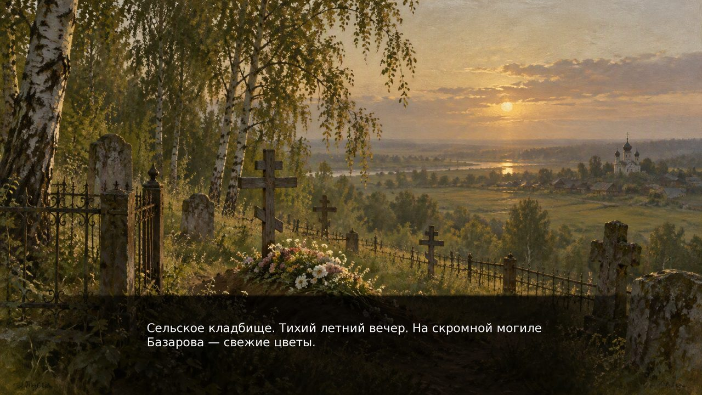
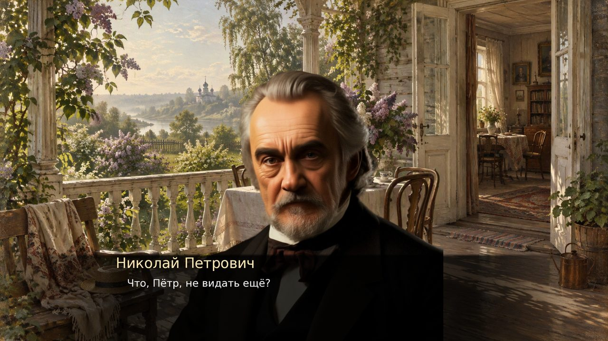
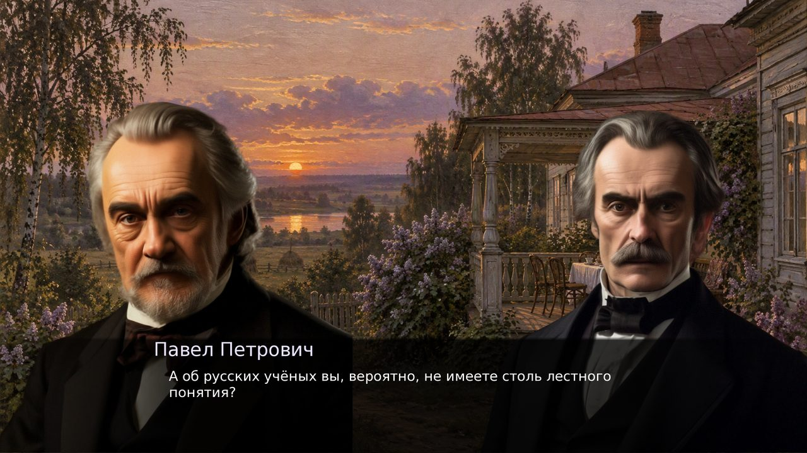
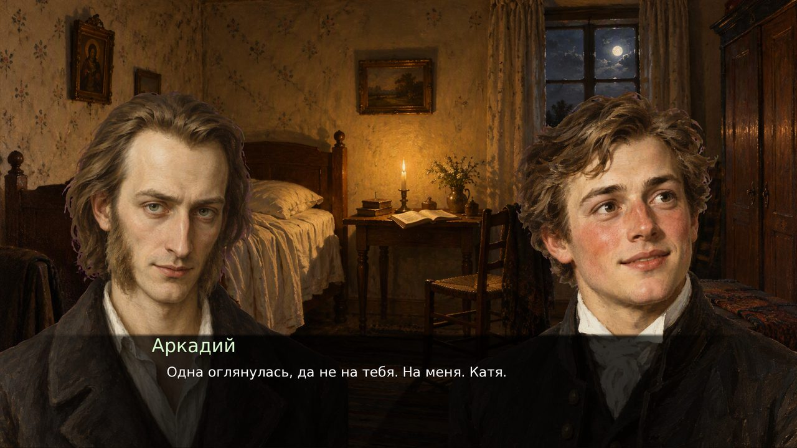
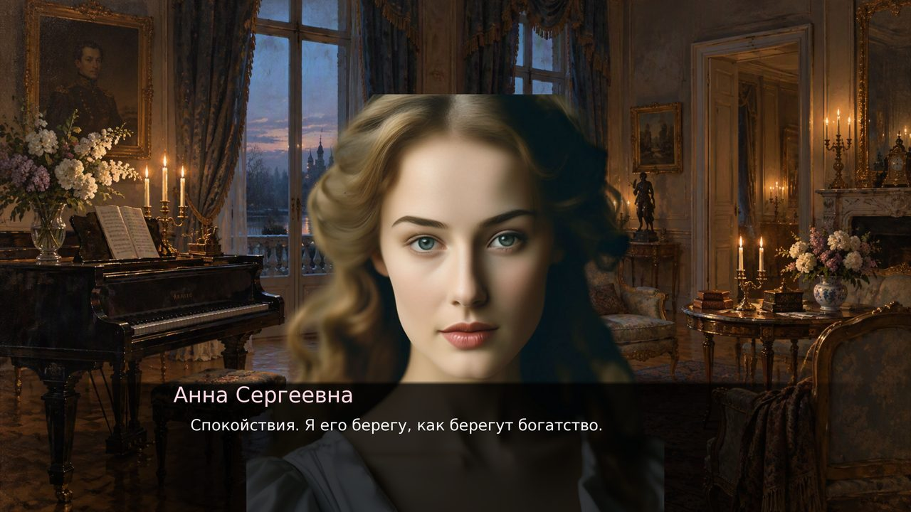
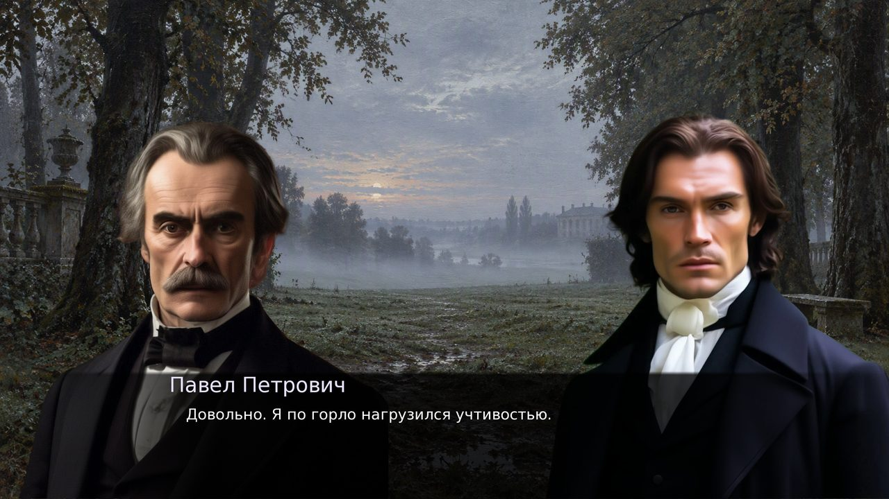
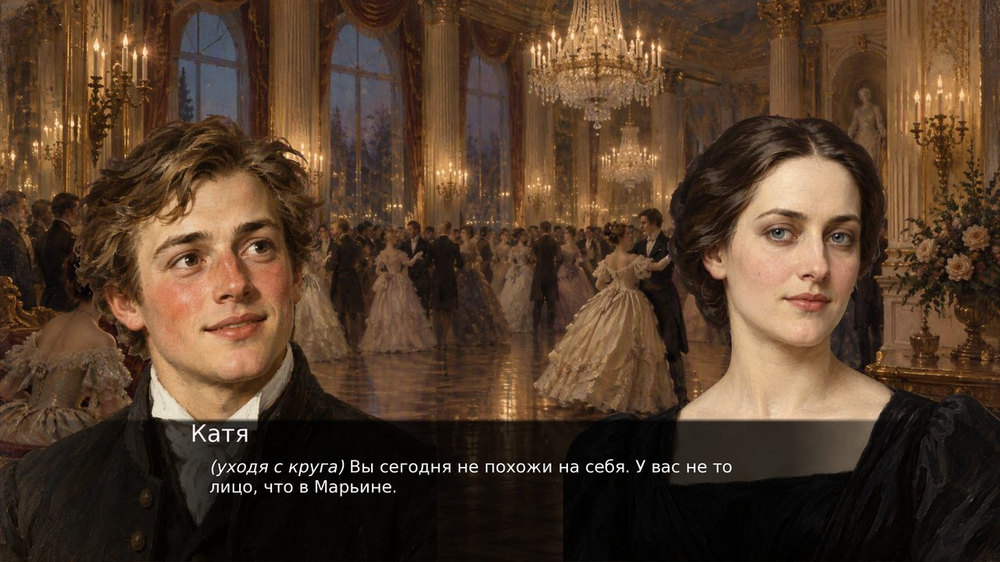
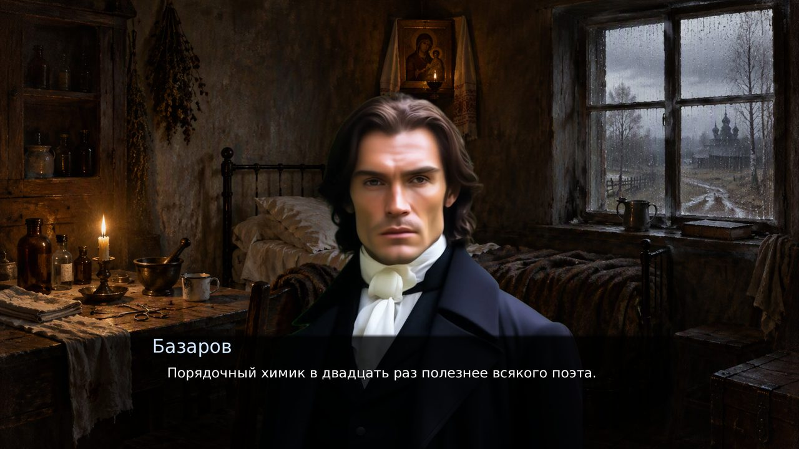

<div align="center">

# ОТЦЫ И ДЕТИ

**Визуальная новелла по роману И. С. Тургенева**

`Ren'Py 8.5.2` · `12 сцен` · `14 карточек глав` · `17 развилений` · `3 концовки` · `10 портретов по тексту` · `нейроозвучка`

**Разработка:** [@wherearethechoice](https://t.me/wherearethechoice) · [@arekssbit4](https://t.me/arekssbit4) — [авторские права](LICENSE)



</div>

---

<div align="center">

### ▶ [Скачать и играть — Windows, 97 МБ](https://github.com/wDemka/otci-i-deti/releases/latest/download/OtciDetiAlpha-1.3-win.zip)

Распакуй архив в любую папку и запусти **`OtciDetiAlpha.exe`** — Ren'Py ставить
не нужно, движок и все 410 реплик озвучки уже внутри.

</div>

---

Весь роман — от постоялого двора в главе I до могилы в эпилоге — перенесён в
кликабельную новеллу без сокращений фабулы. Игрок читает, слушает и решает,
чем всё кончится: текст написан заново, но следует Тургеневу, и финальная
карточка называется «Могила».

| | |
|:--|--:|
| Сцен | **12** |
| Карточек глав | **14** — главы I–XXVIII и Эпилог · 1–2 |
| Развилений | **17** |
| Вариантов выбора | **44** |
| Концовок | **3** |
| Реплик | **500** |
| Слов | **7 368** |
| Озвучено реплик | **410** |
| Чистого звука | **51 минута** |
| Голосов | **18** |
| Одно прохождение | **45–60 минут** |
| Все три концовки | **≈ 2 часа** |

## Сцены

| № | Главы | Место |
|:--|:--|:--|
| 1 | I–II | Постоялый двор |
| 2 | III–IV | Марьино. Вечер |
| 2b | V | История одного брата |
| 3 | VI–VIII | Утро в Марьине |
| 4 | IX–XI · XII–XV · XVI–XVII | Молодые люди → Губернский бал → Никольское |
| 5 | XVIII–XIX | Ночь перед рассветом |
| 5d | XXII–XXIV | Дуэль |
| 5b | XXV–XXVI | Васильевка. Дом Базаровых |
| 6 | XXVII | Скорбный тиф |
| 6b | XXVIII | Похороны |
| 7 | Эпилог · 1 | Свадьбы |
| 8 | Эпилог · 2 | Могила |

Сцена 4 — самая длинная: почти 8 минут звука, три главы идут подряд.

## Три развязки

| | |
|:--|:--|
| **Живая жизнь** | Аркадий и Катя в Марьине, трое детей, Николай Петрович переходит на переводы, Фенечка держит весь дом. |
| **Невозвратное** | Анна Сергеевна приезжает на кладбище одна, без слуг, и не говорит старикам, кто она. |
| **Один в поле** | Тот же постоялый двор десятью годами позже — и привычка говорить вслух с тем, кого больше нет. |

## Как это выглядит

<table>
<tr>
<td width="50%"></td>
<td width="50%"></td>
</tr>
<tr>
<td>«Что, Пётр, не видать ещё?» — глава I</td>
<td>Спор с Павлом Петровичем — главы III–IV</td>
</tr>
<tr>
<td></td>
<td></td>
</tr>
<tr>
<td>Аркадий и Базаров — главы VI–VIII</td>
<td>Анна Сергеевна в Никольском — главы XVI–XVII</td>
</tr>
<tr>
<td></td>
<td></td>
</tr>
<tr>
<td>Дуэль — главы XXII–XXIV</td>
<td>Губернский бал — главы XII–XV</td>
</tr>
<tr>
<td></td>
<td></td>
</tr>
<tr>
<td>Василий Иванович и Арина Власьевна встречают сына — главы XXV–XXVI</td>
<td>Эпилог · 2 — финальная сцена</td>
</tr>
</table>

## Лица героев

Каждый спрайт написан заново — по дословному портрету из романа, а не по
условному «типичному барину». Отсюда и разница между двумя Кирсановыми,
которую в книге не спутаешь.

| | Что говорит Тургенев |
|:--|:--|
| **Базаров** | «Длинное и худое, с широким лбом, кверху плоским, книзу заостренным носом, большими зеленоватыми глазами и висячими бакенбардами песочного цвету…» · «Его темно-белокурые волосы, длинные и густые, не скрывали крупных выпуклостей просторного черепа». |
| **Павел Петрович** | «…человек среднего роста, одетый в темный английский сьют, модный низенький галстух и лаковые полусапожки»; «коротко остриженные седые волосы отливали темным блеском, как новое серебро; лицо его, желчное, но без морщин, необыкновенно правильное и чистое». |
| **Николай Петрович** | «…уже совсем седого, пухленького и немного сгорбленного»; «черты имел маленькие, приятные, но несколько грустные, небольшие черные глаза и мягкие жидкие волосы». |
| **Аркадий** | «…к безбородой, запыленной и загорелой щеке молодого кандидата»; голос «несколько сиплый от дороги, но звонкий юношеский». |
| **Анна Сергеевна** | «…женщина высокого роста, в черном платье»; «спокойно и умно, именно спокойно, а не задумчиво, глядели светлые глаза из-под немного нависшего белого лба». |
| **Катя** | «…девушка лет восемнадцати, черноволосая и смуглая, с несколько круглым, но приятным лицом, с небольшими темными глазами». |
| **Фенечка** | «…молодая женщина лет двадцати трех, вся беленькая и мягкая, с темными волосами и глазами, с красными, детски пухлявыми губками»; «голубая новая косынка легко лежала на ее круглых плечах». |
| **Василий Иванович** | «…высокого, худощавого человека, с взъерошенными волосами и тонким орлиным носом, одетого в старый военный сюртук нараспашку»; ленточку с сюртука он «велел спороть». |
| **Арина Власьевна** | «…ее круглое лицо, которому одутловатые, вишневого цвета губки и родинки на щеках и над бровями придавали выражение очень добродушное»; «надела высокий чепец с шелковыми лентами и голубую шаль с разводами». |
| **Пётр** | «…молодого и щекастого малого с беловатым пухом на подбородке и маленькими тусклыми глазенками»; «и бирюзовая сережка в ухе, и напомаженные разноцветные волосы». |

## Озвучка

Синтез — `edge-tts`: на русский язык в нём ровно два нейронных голоса,
`ru-RU-DmitryNeural` и `ru-RU-SvetlanaNeural`. Различие персонажей делается
скоростью и высотой речи, а не выбором голоса:

| Персонаж | Голос | Скорость | Тон |
|:--|:--|--:|--:|
| Рассказчик | Svetlana | +5 % | −2 Гц |
| Базаров | Dmitry | −4 % | −6 Гц |
| Аркадий | Dmitry | +8 % | +12 Гц |
| Николай Петрович | Dmitry | −2 % | +4 Гц |
| Павел Петрович | Dmitry | +10 % | +2 Гц |
| Анна Сергеевна | Svetlana | −4 % | −4 Гц |
| Василий Иванович | Dmitry | −10 % | −4 Гц |
| Арина Власьевна | Svetlana | +2 % | +2 Гц |
| Фенечка | Svetlana | +8 % | +8 Гц |
| Катя | Svetlana | +6 % | +10 Гц |
| Ситников | Dmitry | +16 % | +8 Гц |
| Козьин | Dmitry | +4 % | −8 Гц |
| Пётр | Dmitry | +10 % | +6 Гц |
| Митя | Dmitry | +14 % | +20 Гц |
| Дуняша | Svetlana | +12 % | +6 Гц |
| Лиза | Svetlana | +10 % | +12 Гц |
| Фома | Dmitry | −12 % | −10 Гц |
| Доктор | Dmitry | +2 % | ±0 Гц |

Файлы лежат в `game/voice/<персонаж>/<хэш>.mp3`, где хэш — срез SHA-1 от
связки `персонаж + текст`. Правка реплики меняет хэш, поэтому старая озвучка
не может остаться при новой фразе, а два одинаковых текста не синтезируются
дважды.

Перед каждой репликой в сценарии стоит оператор `voice`:

```renpy
    voice "voice/bazarov/a9d2e18491316121.mp3"
    bazarov "{i}(лениво, мужественным голосом){/i} Евгений Васильев."
```

Громкость речи — отдельный ползунок в настройках (`config.has_voice = True`),
независимо от музыки и окружения.

## Запуск

**Готовая сборка (Windows).** Скачать
[OtciDetiAlpha-1.3-win.zip](https://github.com/wDemka/otci-i-deti/releases/tag/v1.3)
из Releases, распаковать в любую папку, двойной клик по `OtciDetiAlpha.exe`.
Сборка проверена на Windows 11 x64: лог чистый, трейсбеков нет.

**Из исходников.**

1. Установить [Ren'Py 8.5.2](https://www.renpy.org/latest.html).
2. В Launcher добавить эту папку проекта (или положить её в каталог с играми).
3. **Launch Game**.

**Свои сборки под Linux и macOS** — той же командой, что собрана эта:

```bash
renpy.sh <путь>/renpy-8.5.2-sdk/launcher distribute <путь>/OtciDetiAlpha \
    --package pc --no-update --destination ./dist
```

`--package` принимает `win`, `linux`, `mac` и `pc` (Windows + Linux в одном
архиве). Готовые обновления игры не строятся (`--no-update`), так как раздавать
их пока негде.

## Структура

```
game/
├── script.rpy          весь сценарий: 12 сцен, 17 развилений, 3 развязки
├── options.rpy         имя, версия, has_voice
├── gui.rpy             палитра и шрифты интерфейса
├── screens.rpy         экраны меню, диалога, настроек
├── voice/              410 mp3 по 18 папкам-персонажам
├── images/bg/          10 фонов сцен (1920×1080)
├── images/<герой>/     спрайты персонажей
├── music/  sounds/     темы и шумы окружения
└── gui/                рамки, кнопки, подложки
```

## О тексте

Реплики и ремарки написаны заново, но по фабуле романа: имена, чины,
отношения и порядок событий сохранены. Роман И. С. Тургенева (1862) —
общественное достояние.

## Разработчики

- **[@wherearethechoice](https://t.me/wherearethechoice)**
- **[@arekssbit4](https://t.me/arekssbit4)**

Авторы проекта. По вопросам и предложениям пишите в Telegram.

## Авторские права

**© 2026 wDemka (@wherearethechoice) и @arekssbit4.**

Полный текст — в [`LICENSE`](LICENSE). Коротко:

- **Сценарий, графика, озвучка и сборки** — [CC BY-NC-SA 4.0](https://creativecommons.org/licenses/by-nc-sa/4.0/deed.ru).
  Можно играть, копировать, выкладывать скриншоты и летсплеи, переводить и
  делать свои ответвления — с указанием авторства, только некоммерчески и под
  той же лицензией.
- **Код `.rpy`** — MIT, используйте свободно.
- **Роман Тургенева** — общественное достояние. **Ren'Py** — MIT, права на
  движок и его ассеты остаются за Ren'Py Team; **нейроголоса озвучки** —
  Microsoft (Edge TTS), мы не можем передать на них права.

Продажа игры или её частей без отдельного согласия — нарушение лицензии.
